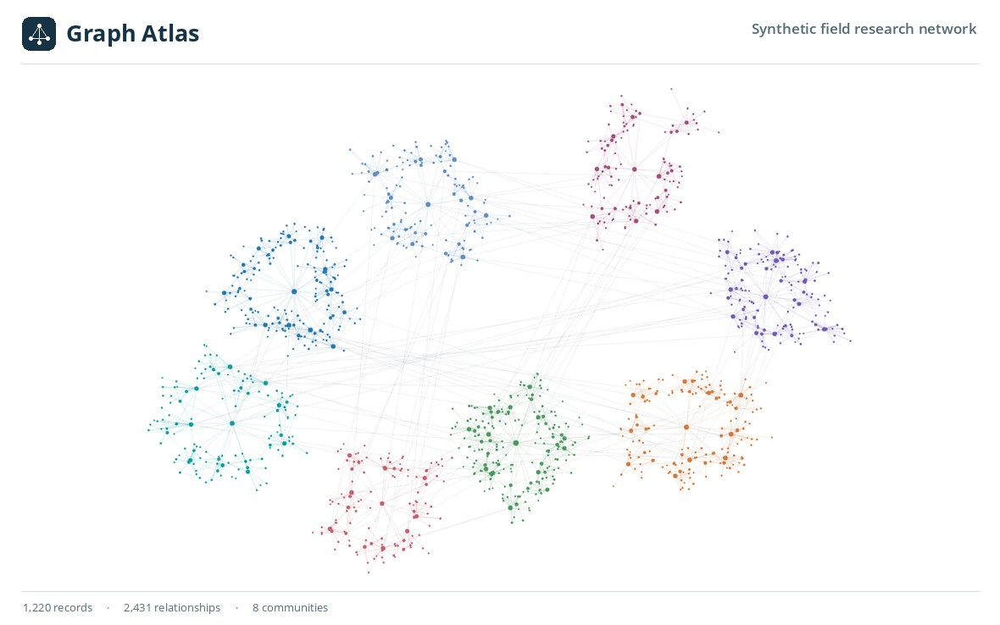

# Graph Atlas

Graph Atlas is an interactive knowledge-graph prototype. It connects records through named relationships and lets you inspect the evidence behind each link. The public demo contains **1,220 fictional research records and 2,431 relationships** across eight communities.

[Open the interactive demo](https://gavcun-bot.github.io/graph-atlas/)



Search for **Ocean Signal Observatory**, select the station, and expand a relationship to see the evidence and follow it to the next record. Scroll to zoom, drag to pan, and select a community in the legend to focus on it. Larger nodes have more displayed connections.

## Run locally

Open `docs/index.html` in a browser. The page runs offline. Use Python 3.10 or later for the command-line tools.

```sh
python web/build_demo.py --json demo.json
python -m atlas import demo.json demo.sqlite
python -m atlas search demo.sqlite "Ocean Signal Observatory"
python -m atlas neighbors demo.sqlite station:ocean-01 --limit 5
```

The generator rebuilds the checked-in demo from a fixed seed. The import command creates a new SQLite snapshot. Use a new output path to import again. Queries report direction and evidence, with pagination via `--limit` and `--offset`.

## How the pieces fit

| Component | What it does |
| --- | --- |
| Canvas viewer | Draws the positioned graph, highlights neighborhoods, and lets you search, filter, and inspect edge evidence. |
| Community layout | Detects clusters from connectivity and positions them with a two-level force-directed layout. |
| SQLite | Stores entity IDs and provenance, with indexed relationship endpoints for neighborhood queries. |
| MCP server | Exposes `search_nodes`, `get_node`, and `get_neighbors` over local stdio. |
| Neural embeddings | Learns vectors from one- and two-hop graph neighborhoods and ranks entities by cosine similarity. |

The viewer accepts graph JSON with `nodes`, `edges`, `groups`, and optional `meta`. Each node carries `id`, `label`, `type`, `source`, and optional `detail`. The viewer also uses `x`, `y`, `g` (group ID), and `d` (degree). Each edge is `[sourceIndex, targetIndex, relationship, evidence]` using zero-based indexes into the node array. Groups supply `id`, `label`, and a hexadecimal `color`. SQLite resolves edge endpoints to stable node IDs.

### Lay out your own graph

Install [Graphviz](https://graphviz.org/download/) and make `sfdp` available on your PATH.

```sh
python -m atlas.layout demo.json positioned.json
python web/build_demo.py --input positioned.json --output custom.html
```

### Connect an MCP client

Configure a local stdio server with your Python executable and absolute paths to the script and database.

```json
{
  "mcpServers": {
    "graph-atlas": {
      "command": "python",
      "args": ["/path/to/graph-atlas/atlas/mcp.py", "--database", "/path/to/demo.sqlite"]
    }
  }
}
```

The server opens SQLite read-only. Tool results include the records returned by the database and are visible to the client that invokes them.

### Train the similarity model

```sh
python -m pip install numpy
python -m atlas.neural train demo.sqlite --output demo-embeddings.npz
python -m atlas.neural related demo-embeddings.npz station:ocean-01 --limit 8
```

The model uses skip-gram training with negative sampling. Similarity is a way to find records to investigate. Use the viewer or MCP tools to check documented relationships.

## Test

```sh
python -m unittest discover -s tests -v
```

The demo data, labels, and evidence are synthetic. This portfolio edition was developed with AI assistance.
